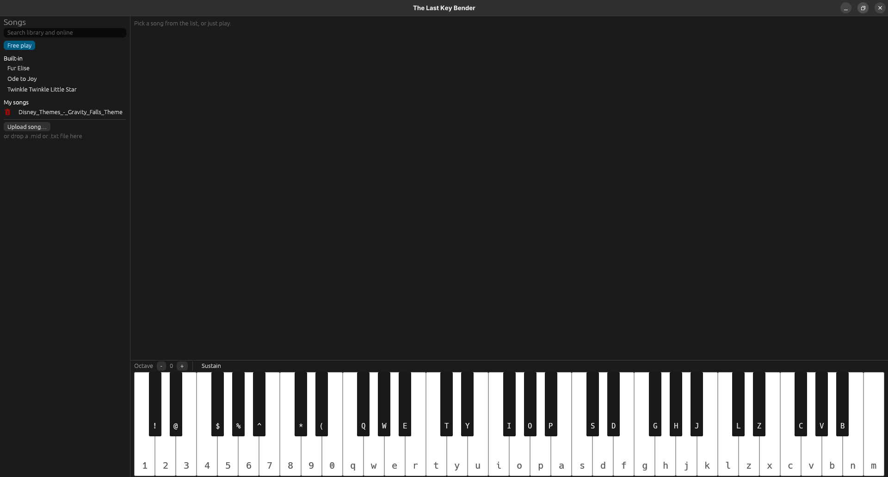
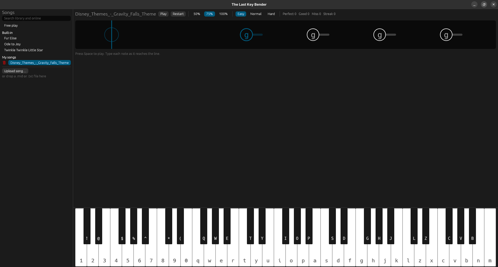
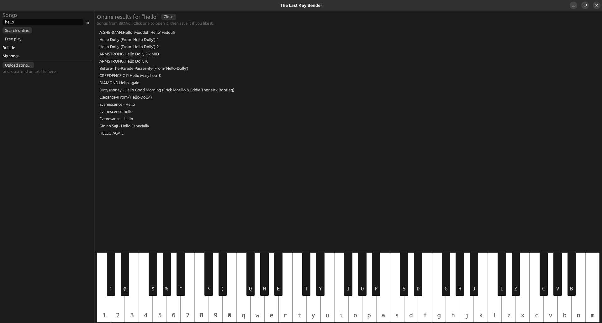

<div align="center">

# The Last Key Bender

**Play the piano with your computer keyboard.**

A desktop piano for Windows, macOS and Linux with real grand piano sound, songs you play along to like a rhythm game, and online song search.

[](https://github.com/dom1of1/the-last-key-bender/actions/workflows/ci.yml)


[](LICENSE)

[Download](#download) · [Screenshots](#screenshots) · [How to play](#how-to-play) · [Build from source](#building-from-source)

</div>

https://github.com/user-attachments/assets/e0584876-0705-4dd4-8190-c1197716768f

## WHY?
Always wanted to play a piano but can't afford one right now. 

What I can do though is express my will programmatically, so here we are.

## Features
- **Real piano sound.** Recordings of a Yamaha grand piano, covering the whole keyboard from C1 to C8, with low enough delay to feel instant.
- **61 keys on your keyboard.** The number and letter rows are the white keys, and Shift plays the black keys. Arrow keys shift the octave, and Space is the sustain pedal.
- **Play along to songs.** Notes scroll towards a line and you type them in time while the backing plays itself. Choose the speed and difficulty, and get scored on every note.
- **Any song you like.** Upload MIDI files or letter sheets, or search thousands of songs online and play them straight away.
- **Works offline.** Everything except the online search works without an internet connection.

## Screenshots
| Free play | Play along | Online search |
|---|---|---|
|  |  |  |

## Download
Download the latest version for your system, extract it and run `the-last-key-bender` (`the-last-key-bender.exe` on Windows):

- [Windows](https://github.com/dom1of1/the-last-key-bender/releases/latest/download/the-last-key-bender-windows.zip)
- [macOS (Apple Silicon)](https://github.com/dom1of1/the-last-key-bender/releases/latest/download/the-last-key-bender-macos-apple-silicon.tar.gz)
- [macOS (Intel)](https://github.com/dom1of1/the-last-key-bender/releases/latest/download/the-last-key-bender-macos-intel.tar.gz)
- [Linux](https://github.com/dom1of1/the-last-key-bender/releases/latest/download/the-last-key-bender-linux.tar.gz)

Older versions are on the [Releases](https://github.com/dom1of1/the-last-key-bender/releases) page.

- **Windows:** if SmartScreen warns you, click *More info* then *Run anyway*.
- **macOS:** the app isn't signed, so the first time, right-click it and choose *Open* (or allow it in *System Settings → Privacy & Security*).

## How to play
### Free play
- The number row and letter rows are the white keys, from C2 to C7. `t` is middle C.
- Hold **Shift** with a key for the black key just above it.
- **← / →** move the keyboard down or up an octave.
- Hold **Space** for the sustain pedal, so notes keep ringing after you let go.
- You can also click the keys with the mouse.

### Songs
- Pick a song from the list and press **Space** to play or pause.
- Type each character as it reaches the line. A dot above a character means a black key, but you don't need Shift in songs.
- **Speed** (50%, 75%, 100%) slows the whole song down. **Difficulty** (Easy, Normal, Hard) sets how many melody notes you type; the rest play by themselves. Each song remembers its own speed and difficulty.
- **Upload song…** or drag a `.mid` or `.txt` file onto the window to add your own.
- To find songs online, type in the search box and press **Enter**. Open a result to play it, and **Save to library** to keep it.

### Writing your own sheets
A `.txt` song is a letter sheet:

```
bpm: 100
t t o o p p o- i i u u y y t-
```

- Each character is a note, and `[tu]` is a chord.
- Each `-` holds the note a beat longer, and `|` is a one-beat rest.
- The optional `bpm:` line sets the speed.

## Building from source
Install [Rust](https://rustup.rs), then run:

```
cargo run --release
```

On Debian or Ubuntu Linux you'll also need:

```
sudo apt install build-essential pkg-config libasound2-dev libxkbcommon-dev
```

## Credits
Piano samples: [Salamander Grand Piano V3](https://archive.org/details/SalamanderGrandPianoV3) by Alexander Holm, licensed under [CC BY 3.0](https://creativecommons.org/licenses/by/3.0/). Trimmed and converted to mono.

Online songs come from [BitMidi](https://bitmidi.com). Each song belongs to its original authors.

## License
The code is released under the [MIT License](LICENSE). The piano samples keep their own CC BY 3.0 license, as credited above.
